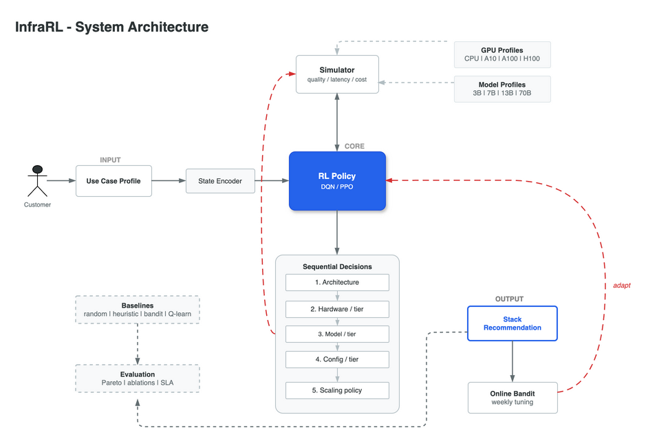

# InfraRL

Reinforcement Learning for Use-Case-Driven AI Infrastructure Recommendation.
MSAI/MSML 635, University of Maryland, Fall 2026.



## Team

- Jay - RL algorithms
- Vishnu - RL engineering
- Anupama - simulator and evaluation

## Deadlines

- Interim Report: Oct 26
- Presentation: last Monday class (Dec 1 or Dec 8)
- Final Report: Dec 7

## Setup

```bash
pip install -r requirements.txt
```

See `proposal.pdf` and `ROADMAP.md` for details. Dataflow and RL loop diagrams in `docs/`.
