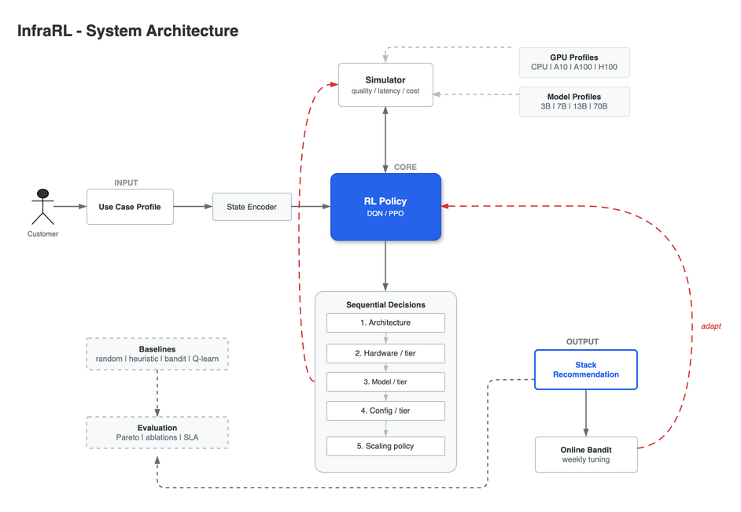

# InfraRL

Reinforcement Learning for Use-Case-Driven AI Infrastructure Recommendation.
MSAI/MSML 635, University of Maryland, Fall 2026.



## Team

- Jay - RL algorithms
- Vishnu - RL engineering
- Anupama - simulator and evaluation

## Deadlines

- Interim Report: Oct 26
- Presentation: last Monday class (Dec 1 or Dec 8)
- Final Report: Dec 7

## Setup

```bash
pip install -r requirements.txt
```

See `proposal.pdf` and `ROADMAP.md` for details. Dataflow and RL loop diagrams in `docs/`.

## Run

```bash
pytest -q tests
python demo.py                                              # original smoke test
python -m infrarl.evaluation.run_experiment --agents random,heuristic,bandit_context_free,bandit_contextual,ppo --seeds 3 --out results/NEW_DEVELOPMENT_RUN
streamlit run infrarl/app.py
```

These compute commands are for local WSL; on Zaratan use the CPU Slurm workflow in
[scripts/zaratan/README.md](scripts/zaratan/README.md). Reuse the existing `.venv`;
login-node scripts do not install packages or execute these workloads.
See `docs/EVALUATION.md` for the protocol, metrics and how to plug in agents.

Status: simulator tables are uncalibrated placeholders (3-config residual check pending).
Random, heuristic, context-free and contextual (LinUCB) bandit baselines, the evaluation harness,
ablations and the Streamlit demo run end to end. PPO is implemented and requires PyTorch. Q-learning and DQN remain empty placeholders;
Online adaptation is outside this experiment update. See `docs/EVALUATION.md`
for how to plug in agents. Calibration reporting exists but matched reference
coverage remains incomplete; internal verification does not establish external calibration.
