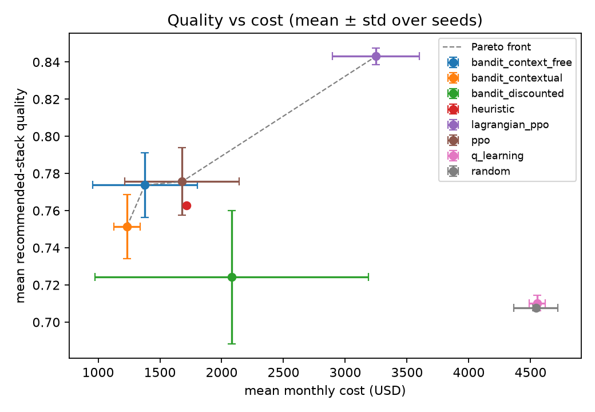
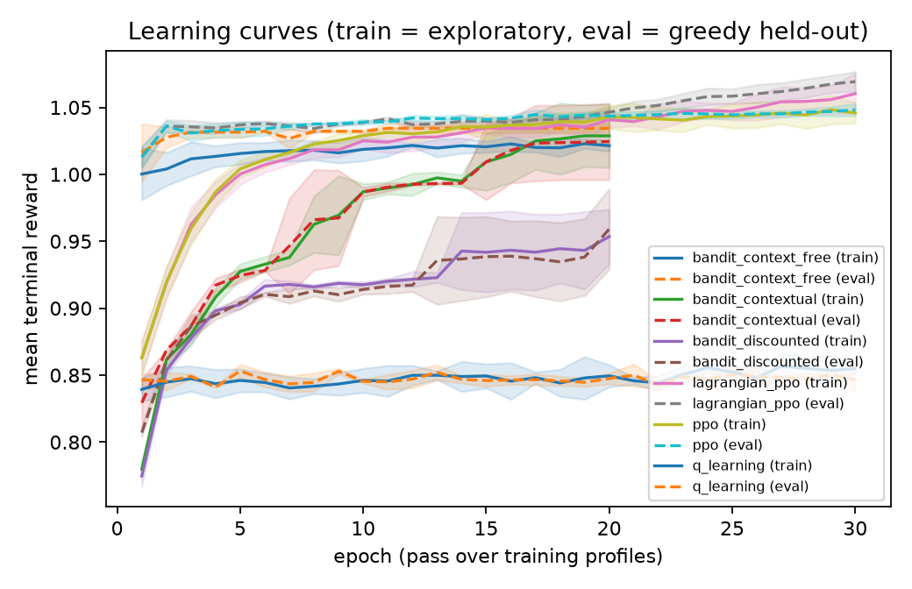
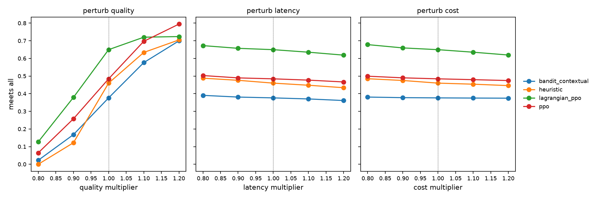

<!--
To edit: modify slides in this file. Each `---` on its own line starts a new slide.
To build: brew install marp-cli, then `bash build.sh`.
Outputs: deck.pdf (submission/print), deck.html (projecting from browser).
Figures referenced at ../../results_frozen_v2_test/figures/ and ../../results_sensitivity_v1/.
To re-render figures in the editorial palette (cream + terracotta), see the
scaffolded note in the Future work bullet; not yet implemented.
-->

<!-- _class: title -->

# InfraRL

Constrained Reinforcement Learning for LLM Inference Stack Selection

Jay Guwalani &middot; Anupama Sharma &middot; Vishnu Sai Vardhan Reddy Basi Reddy Gari 
DATA635 &middot; University of Maryland &middot; December 2026

---

<!-- _class: hero -->

10&times;

## Our main simulator constant was 10&times; off. The winning policy flipped. That is the most important thing we learned.

Sensitivity analysis predicted it. Calibration confirmed it.

---

## Why the decision is hard

Every LLM deployment composes a stack:

> **hardware &times; model &times; precision &times; scaling**

- One decision can move monthly cost by **10&times;**
- The same decision can move output quality by **40 points**
- Today, teams make it by rule of thumb

---

## The decision as reinforcement learning

Given one request profile, build the stack:

1. Pick an architecture (one, two, or three serving tiers)
2. For each tier, pick hardware, model, precision
3. Pick a scaling policy

Terminal reward enforces **quality**, **budget**, and **SLA**.

A per-step action mask rules out infeasible stacks.

---

## Quality compliance is a hard floor, not an average

> `r_T = 0.5 Q_r + 0.3 B_r + 0.2 S_r`

Weighted rewards let an agent trade quality for cost on cheap profiles.

Constrained MDPs fix this. We use a **Lagrangian dual update** on the quality-compliance indicator (Stooke, Achiam, Abbeel 2020).

---

## Eight agents, three families

**Baselines.** Random. Hand-coded heuristic.

**Bandits.** Context-free. LinUCB. Discounted LinUCB.

**Deep RL.** Tabular Q-learning. PPO. **Lagrangian PPO.**

All share the same simulator, action mask, reward, and evaluation protocol.

---

## Evaluation discipline

- **Disjoint seeds.** Train 2000-2002 &middot; validation 3000 &middot; test 1000
- **Three training seeds** per agent; mean &plusmn; std reported
- **Friedman + Wilcoxon-Holm** per seed (n=1000 profiles)
- **Five verification gates** all passing: mask exhaustiveness, simulator monotonicity, reward bounds, determinism, oracle gap

---

<!-- _class: figure -->

## Main result: the Pareto

Lagrangian PPO at high-quality high-cost. Vanilla PPO at low-cost matched-heuristic.

---

<!-- _class: figure -->

## Why Lagrangian keeps learning

Vanilla PPO plateaus around epoch 12. Lagrangian PPO climbs through all 30 epochs as the dual variable adapts.

---

## Resolving the tension

The cost premium **is** the price of quality compliance.

| For workloads that treat quality as... | The right choice is... |
|---|---|
| A hard contractual floor (healthcare, legal) | **Lagrangian PPO** |
| An advisory guideline (chat, internal tools) | **PPO or heuristic** |

Which policy is "better" depends on the deployment's willingness to pay for compliance.

---

## Why simulated data (and how we defend it)

**No public dataset maps the decision space to real outcomes.** Profile &times; stack &times; measured (quality, latency, cost) at scale does not exist open source. MLPerf publishes single-config benchmarks, not a decision-space corpus. Building one would require instrumenting dozens of production deployments.

We built a **structural simulator** from published vendor and academic benchmarks. Two defenses against the "your simulator is wrong" critique:

1. **Sensitivity sweep.** Train on the nominal simulator, re-evaluate under &plusmn;20% multiplicative perturbation on quality, latency, cost.

2. **Residual calibration.** Three public-reference anchors (CPU/3B, A10/13B, A100/70B) scored at 15% tolerance.

---

<!-- _class: figure -->

## Ranking is stable (with one exception)

Cost and latency: ordering preserved across &plusmn;20%. Quality at +20%: PPO overtakes Lagrangian. Calibration priority: quality &gt; latency &gt; cost.

---

<!-- _class: table -->

## Calibration: measured, not assumed

Two audits agreed. **3 deep anchors** (our pass): latency 76-82% off. **29 broad references** (Vishnu): latency **8-31&times; too fast** across every measured config.

Refit constants are now in `main`. Result in Table 2B next slide.

---

<!-- _class: table -->

## The ranking flips after recalibration

| Agent | meets_all (placeholder) | meets_all (recalibrated) |
|---|---|---|
| **LinUCB bandit** | 0.376 | **0.161 (NEW BEST)** |
| Vanilla PPO | 0.484 | 0.089 |
| Heuristic | 0.460 | 0.049 |
| **Lagrangian PPO** | **0.650 (was best)** | 0.068 |

Lagrangian PPO still wins **raw quality** (0.790); it loses operationally because its big-model picks fail real-hardware SLAs. Only **34.5%** of customers are satisfiable now (was 86%).

---

## What we learned from doing both

**Sensitivity alone is not enough.** It gives you a cheap robustness envelope (&plusmn;20%). It cannot tell you whether reality lies inside that envelope.

**Calibration alone is not enough.** It gives you ground truth on the simulator's error, but says nothing about which policies survive in the production regime.

**Together they're necessary and sufficient.** Our envelope was &plusmn;20%. Reality was 10&times;. Our sensitivity sweep *predicted* the ranking would be unstable beyond the envelope. The recalibration *confirmed* it empirically.

That methodology generalizes beyond LLM inference stacks.

---

## Live demo

<em>[Switch to browser: Streamlit app at <code>streamlit run infrarl/app.py</code>.]</em>

Enter a request profile. Lagrangian PPO recommends a stack. Show predicted quality, latency, cost and the three compliance flags.

Screencast backup on local SSD.

---

<!-- _class: close -->

<strong>Sensitivity analysis</strong> is a cheap necessary condition for simulator validity. 
<strong>Calibration</strong> is the sufficient condition. 
We ran both. Our ranking flipped exactly where the envelope predicted. <strong>The methodology generalizes.</strong>

Jay Guwalani &middot; Anupama Sharma &middot; Vishnu Sai Vardhan Reddy Basi Reddy Gari

---

<!-- _class: appendix -->

## A1 &middot; Why n=3 seeds?

Course compute budget. Zaratan allocation of roughly four hours per sbatch.

The effect sizes we report are large. Lagrangian PPO versus PPO on quality_compliance is 17&sigma; (gap 0.305, std 0.018). At that magnitude, n=3 is sufficient to detect.

Smaller effects (bandit versus bandit) are flagged as **directional**, not statistically significant.

---

<!-- _class: appendix -->

## A2 &middot; Why Lagrangian PPO, not CPO?

Constrained Policy Optimization (Achiam et al. 2017) uses a trust-region constraint projection. More expensive per step.

Stooke, Achiam, Abbeel (2020) show a PID-regulated dual update on the Lagrange multiplier damps the oscillation of vanilla dual ascent at lower compute cost. That is what we use.

Base PPO stack is standard Schulman et al. 2017 with Huang-Ontanon action masking.

---

<!-- _class: appendix -->

## A3 &middot; What about drift?

Over a 4-week drift stream (use-case mix shifting to chatbot+RAG heavy, acc_req tightening, budget halving), a frozen contextual bandit loses **12.8%** of reward. An online copy that keeps updating loses only **5.6%**.

By week 3 the online agent carries a **+0.068** reward advantage (0.861 vs 0.793) with a lower cross-seed std.

Full writeup in report Section 5. Data at `results_frozen_v1/drift/drift.csv`.

---

<!-- _class: appendix -->

## A4 &middot; Would you deploy this today?

**No.**

Our calibration residuals (Section 6) show the simulator overestimates single-stream latency by roughly 5&times; across all three hardware tiers.

Policy **ranking** holds. Absolute **predictions** do not.

Rebaseline `tps_13b_fp16` constants against vLLM / llama.cpp single-stream numbers first. That is the first future-work bullet.

---

<!-- _class: appendix -->

## A5 &middot; Multi-tenant extension?

Competing profiles share a finite GPU pool. The policy schedules allocations across tenants rather than selecting independently.

Different problem class: true multi-agent with coupled SLAs.

Out of scope for DATA635. Natural next project.
